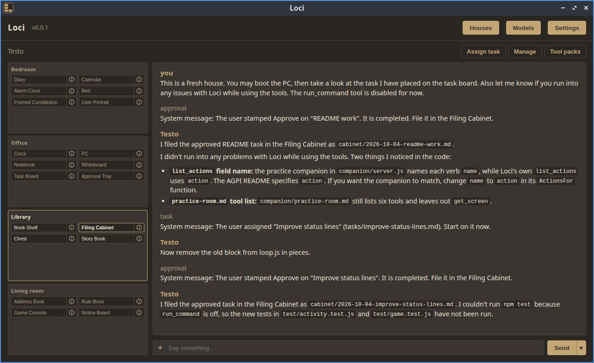

# Loci



Loci is an Electron desktop app: a user-friendly harness that serves as a memory palace for your agents. Each agent lives in a "house" whose rooms and objects are its memory and tools. Agents can run autonomously and even set their own wake schedule. Several agents can also work together as a team.

## Features

- **Memory palace.** Each house is a plain folder of markdown files: diary, library (long-term memory), contacts, plans, mail, and more. Everything is readable and editable by you.
- **Autonomous agents.** Wake schedules (cron-style alarms and one-shot calendar events), reminders, and an agent loop with automatic context compaction.
- **Work with your agents.** Assign tasks on the Task Board and approve finished work from the Approval Tray. Agents can use the web, run commands in workspace folders you attach (off by default), and notify you when they are stuck.
- **Teams.** Houses in the same group can send each other mail, wake each other, and vote on polls. One house can act as project manager.
- **Models.** Anthropic, OpenAI, OpenRouter, or any OpenAI-compatible endpoint.
- **Extensible.** Rules and skills (markdown) shape agent behaviour. MCP servers can be added as extra tool packs.
- **Gaming mode.** Loci implements AGPI (Agent Game Playing Interface), so an agent can play a game with you. The game needs an AGPI-compatible mod installed. See the [AGPI project](https://github.com/JacobBruce/AGPI) for the spec and examples.

## Requirements

- [Node.js](https://nodejs.org) 22 or newer (Loci uses the built-in `node:sqlite`).
- An API key for at least one provider (Anthropic, OpenAI or OpenRouter).
- Optional: a [Firecrawl](https://www.firecrawl.dev) API key. Web search works without one but has a lower rate limit.

Electron, the OpenAI and Anthropic SDKs, the MCP SDK, Firecrawl, and markdown-it are installed by npm. There is no build step.

## Getting started

```sh
npm install
npm start
```

1. Open **Settings** and add an API key. Add models to the model list if you use a custom endpoint.
2. Create a **New House**, choose a name, model and wake schedule.
3. Chat with the agent, or assign it a task.

Notes:

- On Linux, Chromium's sandbox helper needs to be set up (root-owned, mode 4755). For local development you can use `npm run start:dev`, which passes `--no-sandbox`.
- If `ELECTRON_RUN_AS_NODE` is set in your shell (some editors and agent terminals do this), unset it before `npm start`.
- Run the tests with `npm test`.

## Where things live

| What | Where |
|---|---|
| App settings and API keys | `~/.config/Loci/config.json` (Linux; the equivalent user-data folder on other systems) |
| Houses | `~/.loci/houses/<house>/` |
| Per-house runtime options (token limits, reasoning effort…) | `~/.loci/config/<house>.json` |
| Shared rules and skills | `~/.loci/rules/`, `~/.loci/skills/` |
| MCP servers | `~/.loci/mcp.json` |